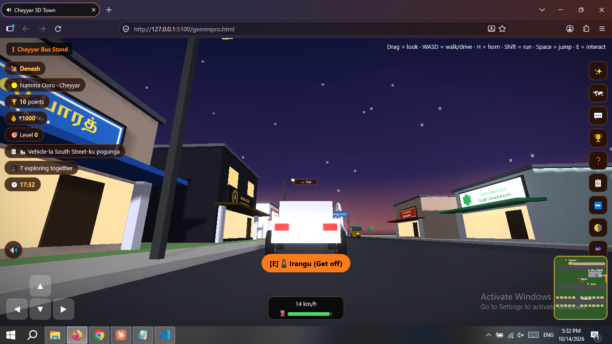

<div align="center">



<a href="https://github.com/Denesh-developer/Cheyyar-3D">
  
</a>

<br/>


-FF7A1A?style=for-the-badge)


**[▶ Play Live](https://denesh-developer.github.io/Cheyyar-3D/geminipro.html)** &nbsp;·&nbsp; **[Features](#-features)** &nbsp;·&nbsp; **[Controls](#-controls)** &nbsp;·&nbsp; **[Run Locally](#-run-locally)**

</div>

---

## 🌆 About

**Cheyyar 3D Town** is an open-world 3D mini-game of Cheyyar, Tamil Nadu. Roam the streets on foot, hop on a bike, auto, car or bus, check the **real bus timetable**, and watch the town shift from day to dusk to night, all inside a single web page. No install, no plugins.

<div align="center">
  
  <br/><sub><i>Driving down the main street at dusk 🌇</i></sub>
</div>

---

## ✨ Features

| | |
|---|---|
| 🏘️ **3D Town** | Streets, shops with Tamil signboards, bus stand and temple gopuram |
| 🚗 **Drive anything** | Cycle, Bike, Auto, Car and Bus, each with its own speed, turning and camera |
| 🚌 **Live bus timetable** | Buses run on your real clock. Board them, pick a seat, and ride |
| 🌅 **Day / Night cycle** | Sky, stars, sunset and street lamps follow the real time |
| 🗺️ **Minimap** | Tap to enlarge and find your way around town |
| ⛽ **Fuel & speedometer** | Live km/h and fuel gauge while driving |
| 🎯 **Points, ₹ and Levels** | Earn rewards, finish small quests and level up |
| 🎭 **Emotes & seating** | Sit down and wave, clap or whistle |
| 🔊 **Sound** | Engine, horn and footstep audio, with a sound toggle |
| 📱 **Mobile ready** | Joystick, touch-look and action buttons in portrait mode |

---

## 🎮 Controls

<table>
<tr>
<td valign="top" width="50%">

### 🖥️ Desktop

| Key | Action |
|:---:|---|
| `W A S D` | Walk / Drive |
| `Mouse drag` | Look around |
| `Shift` | Run |
| `Space` | Jump |
| `E` | Interact (board, get off, enter) |
| `H` | Horn |
| `M` | Sound on / off |
| `Esc` | Stand up / close |

</td>
<td valign="top" width="50%">

### 📱 Mobile (Portrait)

| Touch | Action |
|:---:|---|
| **Left joystick** | Walk / Drive |
| **Drag screen** | Look around |
| **⤒ button** | Jump |
| **🏃 button** | Run |
| **📯 button** | Horn (in vehicle) |
| **Orange prompt** | Interact |

</td>
</tr>
</table>

> 💡 Test the mobile UI on desktop by opening `geminipro.html?mobile=1`.

---

## 🚀 Run Locally

```bash
# 1. Clone
git clone https://github.com/Denesh-developer/Cheyyar-3D.git
cd Cheyyar-3D

# 2. Start a local server (any one)
python -m http.server 5100
# or: npx serve -p 5100

# 3. Open in your browser
# http://127.0.0.1:5100/geminipro.html
```

> ⚠️ Three.js loads from a CDN, so an internet connection is needed on first load.

---

## 🧰 Tech Stack

<div align="center">


</div>

---

## 🗺️ Roadmap

- [x] Walk, drive and ride buses in a 3D town
- [x] Day / night cycle and live timetable
- [x] Mobile joystick, touch-look and portrait layout
- [ ] Offline three.js bundle (no CDN)
- [ ] Android APK release
- [ ] Save progress (points, money, level)
- [ ] More quests and missions
- [ ] Analog / tilt steering for vehicles

---

## 👨‍💻 Author

<div align="center">

**Deneshraja Nedunchezhian**
Founder & Developer, **Cheyyar Bus**

[](https://github.com/Denesh-developer)

<br/>

⭐ **If you like this project, give it a star!** ⭐


</div>